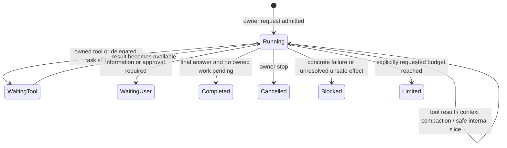

# Continuous owner turns in SOV

Date: 2026-10-24
Status: Proposed. Awaiting Owner approval before implementation.
Owner: Sovereign AI owns SOV and the SDK. Telekit owns its transport adapter.
Source baseline: SDK origin/master `e1a08bb5`; public SOV 0.6.83 / SDK 0.16.3.
Telekit reference: origin/main `660ee83`, public 0.64.36.

## Decision

An owner turn runs until it finishes, the Owner stops it, it needs human input,
or a concrete failure prevents safe work. It has **no default model-call,
tool-call, segment-count, token-total, cost-total, or elapsed-time ceiling**.

Toolsets select tools. They do not select how long the agent may work.

Keep per-request output/context constraints and operation timeouts. Keep optional,
explicit limits for SDK consumers and jobs. A requested limit remains binding.
A runtime slice or transport boundary never means that the Owner's task is done.

This revises the limits decision in
`specs/2026-10-16-resilient-logical-turns-design.md`, sections 1, 3, 5.2 and 7.1.
It preserves that design's durable identity, tool receipts, leases, permissions,
route binding and one final terminal. The earlier spec remains a historical record.

## Why the change must span layers

The 2026-10-24 JulieWajo11Bot turn asked how auto effort works for the
Grok subscription route. Its stored logical turn is
`dda1b560-171b-4156-bc03-100ecb0ef7ab`. It stopped after eight model calls and ten
tool calls. The record says `lastCause: max_turns`, `status: cancelled`, and one
segment. Its configured cumulative ceiling was 100 calls, not eight.

The exact cancellation source is not established by those fields. Do not claim
that removing one constant fixes this incident. The implementation must establish
why the internal boundary became cancellation and add a regression for it.

Current layers, verified in source:

| Layer | Current behavior | Required behavior |
|---|---|---|
| `packages/sdk/src/core/query.ts` | Falls back to 100 calls | Unbounded unless a caller sets a limit |
| `packages/sdk/src/tool/toolset.ts` | chat 1, web 6, ops 8, coding 100 | Tool selection has no implicit call budget |
| `packages/sdk/src/agent/createAgent.ts` | Resolves caller, profile and toolset limits | Resolves only explicit policy; preserves explicit unlimited |
| `packages/sdk/src/agent/logicalTurn.ts` | Defaults to 100 cumulative calls | No cumulative ceiling by default |
| `src/cli/sdkRunCommand.ts` | Forces 100 logical calls and toolset-sized segments | Uses continuous owner policy; finite slices are internal only |
| `src/server/routes/turns.ts` | Uses the direct agent path; does not share the CLI supervisor | Uses the same owner-turn lifecycle |
| Telekit `telekit/agent.py` | Absolute timeout; passes remaining deadline to SOV | Continuous SOV turns have no default absolute deadline |
| Agent scheduler | Default call limit also implies a child timeout | No implicit child ceiling for work delegated by a continuous owner turn |

Two adjacent defects remain relevant: the `ops` selection could not read local
source, and HarnessInfo advertised the assembled tool pool rather than the active
pool. Neither should be hidden by removing limits. Fix the effective tool report
in this work. Toolset-routing changes need a separately reviewed Telekit change;
do not silently grant a larger toolset during continuation.

## Execution contract

The SDK loop remains an async generator. The logical-turn supervisor remains the
owner of durable continuation. Do not add an outer LLM that repeatedly sends
“continue”, a second agent scheduler, or a permanent task daemon.

A normal owner turn uses one continuous model/tool loop. It can span many provider
requests and context compactions. If a host needs finite execution slices, the
supervisor resumes the same turn at a safe boundary without a lifetime slice cap.
The default SDK loop must also work continuously without a supervisor.
This does not enable subscription authentication on the gateway or change which
authentication routes each surface supports.

`WaitingTool` describes internal work, not a new durable status required by this
spec. The durable turn remains active. `WaitingUser` requires a real question or
approval request. A number of calls, silence, a heartbeat, or the absence of a
file edit is not evidence that work is finished or blocked.

The model's final response remains the normal completion signal. Do not create a
new completion-judge model or automatically reopen every final answer. If work
owned by this turn is still running, wait for it or explicitly report an approved
handoff. Do not use unrelated tasks in a global task list to keep a turn open.
For a read-only request, an accurate answer is completion; no world write is needed.

## Limit representation and precedence

Use `number | null` for model-call limits in APIs and JSON. `null` means no limit.
Omission at the root resolves to `null`. Never serialize Infinity or use a huge
integer as an unlimited sentinel. Zero, negative and non-finite values are invalid.

Extend the existing `maxTurns` API and `logicalModelCallLimit` field rather than
adding a competing budget object. `maxTurns` counts provider/model iterations,
not human messages. Document the count precisely. Add nullable handling to
`remainingModelCalls` and the continuation event's `limits.modelCalls`.

- Per-turn override wins over agent configuration. `null` is a real override;
  do not use `??` where it would restore a numeric fallback.
- A capability profile contributes a limit only when the host explicitly supplied
  one. The toolset label contributes none.
- The parent/host authority ceiling still wins. A child cannot use `null` to clear
  a finite parent budget or deadline. Resolve that ceiling separately from defaults.
- A finite execution slice is distinct from the explicit cumulative turn limit.
  Reaching a slice requests internal continuation, not a limited task outcome.
- Compaction, retries and child work cannot reset or bypass an explicit shared
  ceiling. Continue recording usage even when there is no ceiling.

Keep numeric limits on existing jobs that explicitly own them. Audit cron,
mission, workflow and channel policies instead of globally replacing every number.
Any retained built-in job limit must be a visible job policy, not an implicit
SDK default. TUI, CLI, drive, HTTP and direct Telegram owner requests default to
continuous execution. Explicit `--deadline-ms` remains supported and binding. Numeric
`maxToolCallsBeforeCheckin` is an explicit caller policy only; never install a
default periodic ask for permission to keep working.

Default child agent definitions must no longer inject the loader's 50-call
default or derive a wall-clock timeout from that default. A deliberately bounded child definition or
job keeps its explicit policy. When such a child is limited, return an incomplete
result to its parent; never turn `max_turns` into successful completion. The parent
may plan the remaining work, but must not evade an explicit parent or child ceiling.

## Cancellation and terminal outcomes

Separate cancellation of the owner turn from cleanup of a model request, segment,
relay or lease. Internal cleanup cannot abort the parent turn controller.

Only an explicit stop, host shutdown, lost lease or real cancellation signal can
produce interruption. Record its source. A request output limit, context limit,
model-call slice or completed tool result cannot produce `cancelled`.

Keep these user-visible distinctions:

| Outcome | Meaning and reply |
|---|---|
| completed | Final answer; owned work is complete or an agreed handoff is stated |
| waiting_user | State the missing answer or approval and what is saved |
| cancelled | Acknowledge the stop; never auto-resume |
| blocked/failed | Name the concrete obstacle, saved state and useful next step |
| limited | Name the explicit caller policy that stopped work; task is incomplete |
| internal continuation | Progress event only; no final error or owner action |

Use existing wire outcomes where their semantics fit. If a new outcome is needed,
version it and test every consumer. No generic max-turns warning reaches an Owner
because of a runtime default. A deterministic fallback reply must remain available
when the model/provider cannot produce the terminal explanation.

## Context, retries and waiting

Use the existing model-aware context manager and compaction lineage. Preserve the
request, constraints, decisions, completed actions, pending work and tool receipts.
Compact before the next request exceeds the verified context window. Rebuild the
request against the compacted state; no duplicate original prompt or effects.
An unreducible context or failed compaction is an actionable blocked outcome.
Keep active context, loop evidence and telemetry buffers bounded in memory. Store
history durably and page it when needed; do not reload or resend the whole lifetime
transcript for every iteration. Long work must not require unbounded RAM.

Per-response output-token caps stay. Continue a truncated answer from the durable
boundary without repeating saved text. Never execute a partial tool call.

Provider retries stay bounded per failure episode and use backoff. Successful
work clears the episode; a long productive task must not consume a lifetime retry
allowance. Permanent auth, balance and request errors need action, not endless
retry. Provider/account/route/model switches remain explicit host/Owner choices.

Wait on known tools and child tasks through completion events or host timers.
Waiting does not require repeated LLM calls. Per-operation timeouts identify a
specific stuck request/tool; they do not impose a lifetime deadline on the task.
A slow provider with a live request is not failed solely because stdout is quiet.
Long-running tools should return task handles or progress events so an active
operation can keep running. A short tool timeout must not become another implicit
lifetime cap on useful work.

## Work that makes no progress

Keep progress-aware recovery, but do not replace the removed work cap with a
countdown that kills productive long tasks. Share detector state across optional
slices; a new slice must not erase repeated-failure evidence.

- New result content, cursor/page movement, changed artifact state, or a changed
  owned task state are useful progress. Read-only investigation can progress.
- Transcript ids, new timestamps, lease renewals, assistant wording and successful
  no-op writes alone are not useful progress.
- An identical call with a changed result can progress. Known waiting/polling must
  not trigger an identical-input abort; use the host waiting path.
- Repeated identical errors or unchanged results trigger guidance to change the
  approach. If the concrete obstacle persists after recovery, return a clear
  blocked result. Do not ask for “continue” just to reset a hidden counter.
- Guidance/repair attempt thresholds bound a failure episode. They never measure
  total productive work. Test useful pagination and repeated searches separately.

This is a deterministic recovery policy, not a claim that software can prove all
open-ended work complete or perfectly detect every semantic loop. Progress and
cost telemetry remain visible so the Owner can redirect or stop the agent.

## Durable state and compatibility

Introduce logical-turn record version 2 with nullable `logicalModelCallLimit` and
an explicit policy origin (`owner`, `host`, `job` or `legacy`). Store the resolved
policy at admission. Keep version-1 readers/migration support for existing rows.

Existing numeric version-1 ceilings and deadlines remain binding on resume. Do
not silently reinterpret an in-flight or cancelled old turn as unlimited. Provide
an explicit, recorded policy-migration path after validating receipts, pins and
cancellation state. A cancelled turn does not auto-resume under a new policy.

Extend the machine capability advertisement to distinguish continuous-turn
support from version-1 recovery. Keep the existing recovery fields for older
adapters; add a capability for continuous execution with optional explicit limits.
Version-1-only readers must reject version-2 records clearly; they must never
coerce null into zero or restore the old default. New hosts check the capability
before sending a no-default-deadline policy. Older binaries
get a clear compatibility result rather than a false promise of continuity.

Persist after each completed message/tool boundary. Keep single-owner leases,
receipt-based replay safety and pinned route/model/permissions. Unknown effects
block automatic replay. A process crash does not imply a new task or authorization.
The host can resume safely from the durable turn only while its runner is alive
or through an explicit existing recovery service. No background work is promised
from a one-shot process that has already exited.

## Telekit integration

Deliver a separately owned adapter change alongside SOV support. On a capable
SOV owner turn, do not derive `--deadline-ms` from the legacy max-time default and
do not kill the child at that same elapsed duration. This must be a supported,
versioned execution contract, not a machine-level environment override.

Keep explicit owner/host deadlines. Existing `/timeout` or environment limits
need origin-aware migration: defaults become continuous; deliberate user settings
remain finite. If provenance cannot distinguish them, preserve the finite setting
and show it as an explicit compatibility constraint until it is resolved. Do not
claim end-to-end continuity while a finite host policy remains active.

The same live host owns cancellation, child exit, progress and final delivery.
Heartbeat/status updates cost no model calls. They do not count as work progress
or endlessly reset a genuinely stuck individual operation. Preserve existing
stream preferences and avoid one Telegram message per internal segment.

The old-SOV bounded continuation shim stays bounded for legacy binaries. It must
never become a hidden lifetime cap for new SOV. Do not change other harnesses'
timeout behavior as a side effect. Do not restart the installed bridge to deliver
a design or infer release/installation authority from this specification.

## Acceptance and delivery

Required automated cases:

1. A deterministic tool task completes after more than 8, 100 and 1,000 model
   calls without changing policy. Include pagination and read-only investigation;
   verify that active context stays within the model window after compaction.
2. A fake-clock owner task crosses the former host deadline with active work and
   completes. No real multi-hour test is needed.
3. Explicit numeric SDK, parent, child and deadline ceilings stop precisely and
   report incomplete work. `null` never clears a parent ceiling.
4. Internal slice cleanup never cancels the logical turn. Reproduce the observed
   `max_turns`/cancelled case and prove its cause is corrected.
5. Multiple compactions and output continuations finish without duplicate effects,
   repeated prompt admission, repeated hooks/learning capture, or double billing.
6. Owner stop is prompt during generation, tool wait, backoff and compaction;
   restart does not resurrect cancelled work.
7. Lease loss, crash after a confirmed effect, unknown effect and storage failure
   preserve the existing recovery guarantees.
8. Repeated empty/error results lead to guidance and an actionable blocked reply;
   new pages, changing results and owned task waiting do not falsely stall.
9. Zero/negative/non-finite limits are rejected; null round-trips through config,
   records and events; version-1 finite policies retain their meaning on resume.
10. Effective tool reports match schemas and execution. A missing toolset cannot
    cause endless skill lookup or silent permission expansion.
11. Terminal state is shared across CLI, TUI/drive/HTTP and Telekit. Progress does
    not appear as completion, cancellation or a new human turn.
12. Telekit tests cover capability negotiation, legacy limits, explicit deadlines,
    process death, stop and no-default-timeout behavior without changing Codex or
    Claude handling.

After approval: write the implementation plan; build and review SDK/SOV changes
on a feature branch; coordinate the Telekit adapter through its node. Run the full
configured gates, deterministic long-work tests, packed-consumer checks and a
controlled live test through the same chat path with read-only tools. A fixture
proves a mechanism; it does not prove unlimited real-world task completion.

Update current CLI/API/config documentation, migration guidance, testing log and
state snapshot when implementation lands. Keep release versions with the release
manifest process. This proposed spec changes no runtime, account, bot or service.

## Cross-references

- [Prior logical-turn design](2026-10-16-resilient-logical-turns-design.md)
- [Runtime architecture](../docs/02-architecture/runtime-architecture.md)
- [Loop guard design](2026-08-25-progress-aware-loop-guard-design.md)
- [Claude agent loop](https://code.claude.com/docs/en/agent-sdk/agent-loop) —
  documented uncapped execution when no turn/budget limit is supplied.
- [Codex agent loop](https://openai.com/index/unrolling-the-codex-agent-loop/) —
  tool/result iteration until the final assistant message, with context management.
  This supports the lifecycle design; it is not a claim about every hosted limit.
